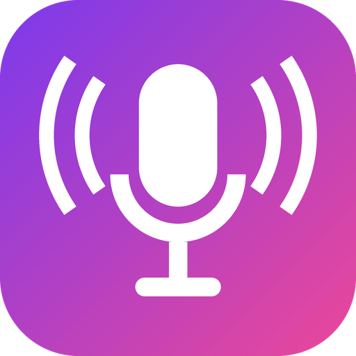

<p align="center">
  
</p>

<h1 align="center">VoicePad</h1>

<p align="center">
  Soundpad de memes para Windows: aperte <b>Ctrl + 0</b> e o teclado numérico vira uma mesa de sons.<br>
  Funciona em calls de jogos e no Discord usando um cabo de áudio virtual.
</p>

---

## Recursos

- **Ctrl + 0** liga e desliga o modo VoicePad, mesmo com a janela minimizada ou dentro do jogo.
- Com o modo **ativo**, as teclas **0 a 9 do numpad** tocam os sons e não digitam números. A tecla **.** para tudo.
- Com o modo **inativo**, o teclado numérico funciona normalmente.
- **Duas saídas de áudio ao mesmo tempo**, cada uma com o seu volume: uma para a call (ex.: CABLE Input) e outra para você ouvir (seus fones).
- Aceita **mp3, wav, ogg e flac**. Os sons escolhidos são copiados para a pasta `sons/`.
- Ícone na **bandeja do Windows**: colorido com bolinha verde quando ativo, cinza quando inativo.
- Opção **Iniciar com o Windows**, que abre direto na bandeja.
- Aviso na tela ao ligar e desligar, e opção para sobrepor sons ou tocar um de cada vez.

## Instalação

Requer **Windows** e **Python 3.10+**.

```bash
git clone https://github.com/BergeS7/VoicePad.git
cd VoicePad
pip install -r requirements.txt
```

Para abrir, dê dois cliques em **`Abrir VoicePad.bat`** ou rode:

```bash
pythonw voicepad.py
```

### Gerar o .exe

Para ter um `VoicePad.exe` que roda sem Python instalado:

```bash
pip install pyinstaller
gerar_exe.bat
```

O `VoicePad.exe` aparece na pasta do projeto. O `config.json` e a pasta `sons/` ficam ao lado dele.

## Como usar

1. Clique em uma tecla vazia da janela e escolha um som. Com o botão direito, você troca, toca ou remove o som.
2. Aperte **Ctrl + 0** para ativar o modo e use o teclado numérico para tocar.
3. Fechar a janela (X) só esconde o programa na bandeja. Para fechar de vez, clique com o botão direito no ícone e escolha **Sair**.

## Usando em calls (jogos, Discord)

O jogo só escuta o microfone, então é preciso um cabo de áudio virtual:

1. Instale o [VB-CABLE](https://vb-audio.com/Cable/) (grátis) e reinicie o PC.
2. **Sua voz no cabo:** aperte `Win + R`, digite `mmsys.cpl`, abra a aba **Gravação** e entre nas propriedades do microfone. Na aba **Escutar**, marque **Escutar este dispositivo** e escolha **CABLE Input**.
3. **No VoicePad:** em *Saída principal*, escolha **CABLE Input**. Em *Ouvir também em*, escolha os seus **fones**.
4. **No jogo ou no Discord:** em microfone, escolha **CABLE Output**.

> Dica: desative a supressão de ruído (Krisp etc.) do Discord e do jogo, senão ela corta os sons. Se o atalho não funcionar dentro de um jogo aberto como administrador, abra o VoicePad como administrador também.

## Estrutura

```
voicepad.py          programa principal
Abrir VoicePad.bat   atalho para abrir sem terminal
assets/              logo (png/ico) e o script que a gera
sons/                seus áudios (fora do Git)
config.json          suas configurações (fora do Git)
```

## Licença

[MIT](LICENSE)
